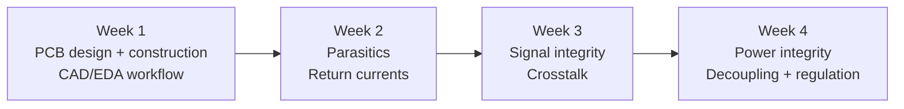
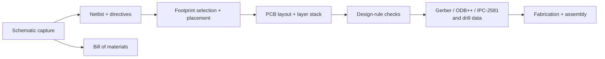
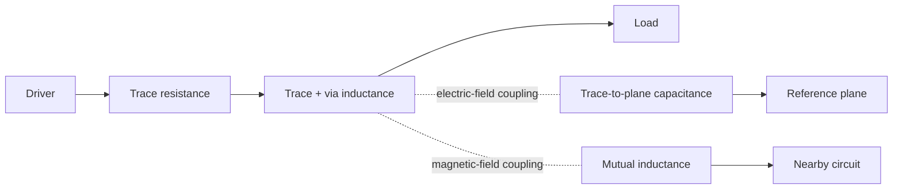
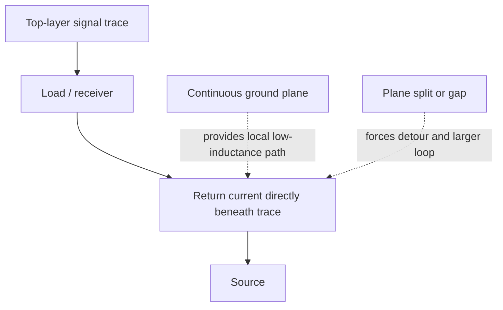
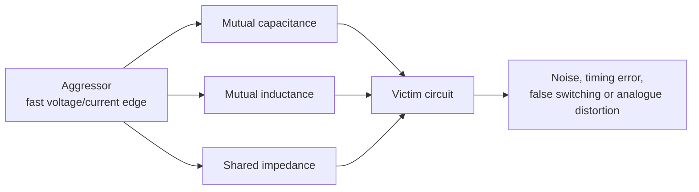
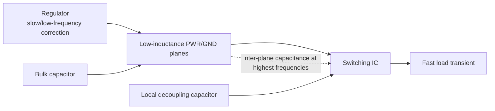
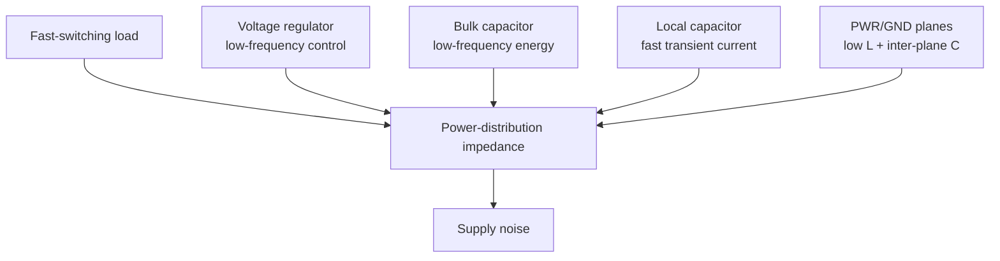
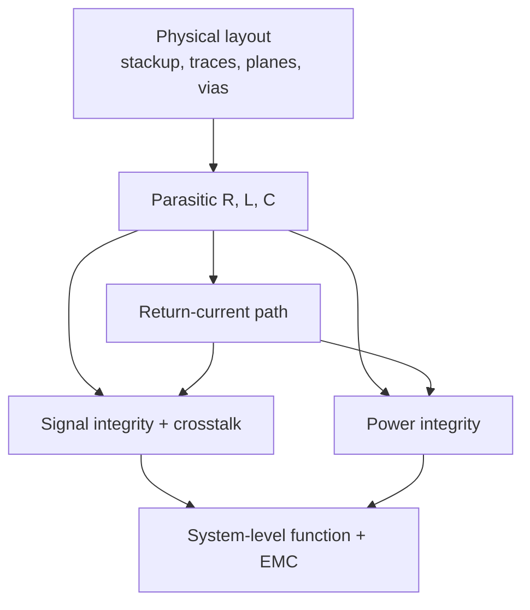

# EEEN30171 High Speed Digital and Mixed Signal Design - Weeks 1-4

Refined notes based on the supplied lecture and video-note PDFs. The central theme is that a PCB is an electromagnetic implementation of a circuit: connectivity alone does not fully determine high-speed behaviour.

## Course arc

## Week 1 - PCB design, construction, and CAD/EDA

Canvas: [Introduction - Week 1](https://canvas.manchester.ac.uk/courses/87860/pages/introduction-week-1).

### The design problem

- A schematic is mainly a graphical netlist: it says what is connected to what, but omits many physical details.
- A PCB implementation also depends on layer count, board thickness, trace width/length, material, proximity to other conductors, component footprints, vias, power/ground arrangements, and mechanical constraints.
- Therefore, “correct connectivity” is necessary but not sufficient. Layout can determine functional performance, signal integrity, power integrity, and EMC compliance.
- Pre-layout circuit simulation is not sufficient for high-frequency designs because the physical implementation contributes significant parasitics.

### Modern PCB flow

- **Schematic capture** produces a graphical design, netlist, net names, route constraints, and a bill of materials.
- Each schematic component maps to a PCB footprint; each component pin maps to a specific pad or connection.
- **Layout** transfers connectivity into a physical board but also adds information that the schematic cannot express, especially power/ground and return-current design.
- **Design-rule checking (DRC)** catches clearance, connectivity, and manufacturing-rule errors. Manufacturing data should not be released while DRC errors remain.
- Neutral/manufacturing data formats include ODB++, Gerber/Gerber X2, and IPC-2581; tool-specific files may also be used.
- ECAD-MCAD co-design matters because the PCB is usually a sub-assembly within a larger product and may feed mechanical or thermal simulation.

### Engineering mindset

For every important net, ask:

1. Where does the signal current flow?
2. Where does its return current flow?
3. What impedance, fields, and coupling are introduced by the physical route?

Altium Designer is used in the unit as a vehicle for applying these principles. The objective is not merely to learn a particular tool, but to design effectively using CAD as an engineering tool.

## Week 2 - Parasitics and return currents

Canvas: [Introduction - Week 2](https://canvas.manchester.ac.uk/courses/87860/pages/introduction-week-2).

### Parasitics are part of the circuit

Every real interconnect has unwanted electrical properties:

- **Resistance:** `R = rho*l/(w*h)`. For 1 oz copper, the sheet resistance is approximately `0.48 mOhm/square`; longer and narrower traces have greater resistance.
- **Capacitance:** a trace over a reference plane forms capacitance to that plane. A rough parallel-plate model is `C = epsilon*A/d`; closer planes and larger overlap increase capacitance.
- **Inductance:** changing current produces an induced voltage, `V = L*di/dt`. Inductance is strongly controlled by loop geometry and the fields enclosed by the current path.
- **Impedance:** frequency-dependent effects can be expressed with `Z_L = j*2*pi*f*L` and `Z_C = 1/(j*2*pi*f*C)`.

### Return-current paths

- Current always returns to its source along the easiest available path. “Ground” is often the return conductor, not an abstract zero-voltage point.
- At low frequency, resistance has more influence on current distribution. At high frequency, inductance makes current prefer a path close to the signal, because that minimises loop area and magnetic energy.
- A solid ground plane directly under a signal trace gives a local, low-inductance return path and confines the electric and magnetic fields.
- Slots, splits, gaps, layer changes, and long detours force return current away from the signal and increase loop area, impedance, coupling, and radiation.

### Inductance and partial inductance

- Total loop inductance includes self-inductance and mutual-inductance terms between parts of the loop.
- **Partial inductance** lets us reason about individual structures such as a trace, via, pad, or plane section. Its useful value depends on how that structure couples to the rest of the loop.
- For a trace over a plane, net inductance can be understood as the trace's self partial inductance reduced by coupling to the return plane. Smaller trace-plane separation usually reduces net inductance.
- A wider trace helps, but bringing the signal closer to a wide return plane is often more effective than simply making a trace thicker.

## Week 3 - Signal integrity and crosstalk

Canvas: [Introduction - Week 3](https://canvas.manchester.ac.uk/courses/87860/pages/introduction-week-3).

### Signal integrity

Signal integrity describes whether a signal arrives at its intended receiver with an acceptable waveform, amplitude, timing, and reference. Poor routing, termination, discontinuities, and parasitic networks can create ringing, overshoot, undershoot, distortion, or false switching.

A square wave is not only its repetition frequency: a fast edge contains substantial high-frequency content. The edge rate therefore matters when deciding whether a trace behaves as a simple wire or as a frequency-dependent network.

### Crosstalk definition and mechanisms

**Crosstalk** is contamination of a victim circuit by a changing aggressor circuit through unwanted coupling.

| Mechanism | Physical origin | Key relation / intuition |
|---|---|---|
| Shared impedance | Circuits share part of a trace, plane, supply, or return path | `V = Z_shared * I`; can matter at any frequency |
| Mutual capacitance | Aggressor electric field couples into victim | `I_m = C_m * dV_A/dt` |
| Mutual inductance | Aggressor magnetic field couples into victim loop | `V_m = L_m * dI_A/dt` |
| Antenna/radiative coupling | Far-field electromagnetic radiation | Usually less important than near-field board coupling for short PCB traces, but important for EMC |

### What sets crosstalk severity?

- Aggressor `dV/dt` and `dI/dt`: shorter rise/fall times usually increase coupling.
- Mutual reactance: larger `C_m` or `L_m` means stronger coupling.
- Victim susceptibility: a high-impedance victim generally develops a larger coupled voltage than a well-driven low-impedance victim.
- Physical geometry: spacing, parallel-run length, reference-plane distance, and return-path continuity.
- Shared impedance can be important even at low frequencies. The slides give an example of approximately 10 nH versus 20 mOhm for 1 cm of 0.25 mm trace; inductive impedance overtakes the resistive value above roughly 300 kHz.

### Design strategies

- Increase spacing and reduce parallel-run length.
- Route high-speed signals close to a continuous reference plane.
- Keep clocks and other fast aggressors away from sensitive analogue or sensor circuits.
- Avoid shared narrow return paths and shared supply/ground impedance.
- Route adjacent-layer traces orthogonally where appropriate.
- Reduce edge rate when timing allows; use differential signalling where suitable.
- Use a solid plane as a return path and screening structure.
- Good functional layout and good EMC layout are usually aligned, not competing goals.

## Week 4 - Power integrity

Canvas: [Introduction - Week 4](https://canvas.manchester.ac.uk/courses/87860/pages/introduction-week-4).

### The problem

Power integrity is the ability of the PCB power and ground arrangement to maintain stable voltage when the load changes. A synchronous digital circuit may switch many outputs almost simultaneously, creating a large transient current.

The disturbance is driven by both resistance and inductance:

`V_drop = I*R + L*di/dt`

Wider or thicker traces reduce resistance, but they do little to reduce inductance unless the signal/return geometry is also improved. The lecture notes quote a typical supply-trace net inductance that is difficult to reduce below about 1 nH/cm using ordinary traces.

### Two complementary solutions

1. **Store charge locally:** use capacitive decoupling so the load can draw transient current from a nearby reservoir instead of through a long inductive path.
2. **Reduce distribution inductance:** use wide, closely coupled conductors, dedicated power/ground planes, short connections, and carefully placed vias.

High-speed designs generally use both.

### Capacitive decoupling

- A capacitor acts as a local charge reservoir. Between transients it can recharge slowly; during a fast transient it supplies current locally, reducing the voltage drop across distant `R` and `L`.
- The IC effectively sees an LC-filtered supply rather than the raw supply network.
- Real capacitors have **ESR** and **ESL**. Above self-resonance, a capacitor becomes inductive; at self-resonance it appears approximately resistive.
- Small capacitors remain useful to higher frequency but store less charge. Larger capacitors store more charge but cannot provide the fastest current through their parasitic inductance.
- The design target is low power-to-ground impedance over a wide frequency range. Multiple capacitor values and sizes may be used, but the complete mounting and interconnect geometry matters as much as the nominal capacitance.
- At the highest frequencies, even small chip capacitors become ineffective and the PCB's closely spaced power/ground planes provide important inter-plane capacitance.

### Placement and via inductance

- The capacitor-to-IC transient loop must have very low inductance: place the capacitor close to the power pins and minimise trace/via length.
- Dedicated planes distribute power and ground with much lower inductance than traces; the notes state that a plane's inductance contribution can be 2-3 orders of magnitude smaller than a trace's.
- Double vias are intended to reduce inductance, but mutual coupling means they do not achieve exactly half the inductance; the notes give an improvement of roughly 27-31% for the illustrated separations.
- Via placement can either worsen or exploit mutual inductance. Closely and appropriately placed power/ground via pairs can reduce net inductance.
- Plane pairs may be partitioned into multiple voltage regions on mixed-signal boards, but power partitioning should follow the signal-domain partitioning and preserve sensible return paths.

### Voltage regulation

- A voltage regulator is a closed-loop controller that maintains an output voltage against line-voltage and load-current variation.
- Regulators usually have limited bandwidth, typically below 100 kHz in the course material, so they handle slower changes rather than the fastest digital edges.
- Input and/or output capacitors are often required for regulator stability; the regulator sees an RLC-filtered version of the true load.
- A practical power-distribution hierarchy combines bulk capacitors for lower-frequency energy, local decoupling for faster transients, planes for low-inductance distribution and inter-plane capacitance, and the regulator for low-frequency correction.

## Key equations and rules of thumb

| Quantity | Relationship | Design meaning |
|---|---|---|
| Resistive drop | `V_R = I*R` | Reduce with shorter, wider, thicker conductors |
| Inductive drop | `V_L = L*di/dt` | Reduce loop area, trace-plane spacing, and via/connection inductance |
| Inductor impedance | `Z_L = 2*pi*f*L` | Inductance matters more as frequency increases |
| Capacitive coupling current | `I_m = C_m*dV_A/dt` | Fast voltage edges increase capacitive crosstalk |
| Inductive coupling voltage | `V_m = L_m*dI_A/dt` | Fast current edges increase inductive crosstalk |
| Capacitor impedance | `Z_C = 1/(2*pi*f*C)` ideally | ESR/ESL limit real high-frequency performance |

## Cross-week mental model

## Quick revision checklist

- Explain why a schematic is not a complete manufacturing specification.
- Describe the schematic -> netlist/BOM -> placement/routing -> DRC -> manufacturing flow.
- Estimate how trace geometry affects resistance and capacitance.
- Explain why high-frequency return current follows the signal closely over a reference plane.
- Distinguish self, mutual, and partial inductance.
- Define signal integrity, aggressor, victim, and crosstalk.
- Use `I_m = C_m*dV/dt` and `V_m = L_m*dI/dt` to explain coupling trends.
- Distinguish shared-impedance, capacitive, inductive, and radiative coupling.
- Explain why fast edge rate matters even when the clock repetition frequency is modest.
- Explain why decoupling capacitors, plane pairs, via placement, and regulators cover different frequency ranges.
- Explain ESR, ESL, and self-resonance.
- Distinguish low-frequency voltage regulation from fast transient-current support.

## Source set

The refinement used the supplied PDFs covering the unit introduction, CAD/EDA flow, parasitics and return currents, crosstalk mechanisms and examples, signal integrity, and the three power-distribution lectures.
